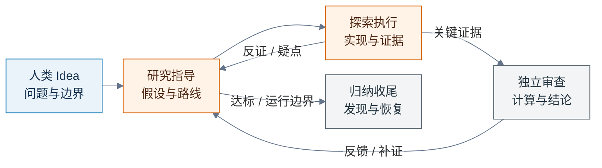

# Auto-Loop：多智能体科研探索

**中文版本 0.1.10 · [MIT 许可证](LICENSE)**

[快速开始](#快速开始) · [探索流程](#探索-loop-如何运作) · [安装技能](#安装技能) · [填写 Idea](#填写-ideamd) · [更新与回退](#更新与回退)

Auto-Loop 是面向 Codex 的科研探索技能。人类定义研究问题、可用材料、实验因素和完成标准；智能体在这些边界内执行研究、探索有依据的创新方法，用实际、可复算的证据检验假设，并根据结果调整路线。

研究可以围绕方法、规律、可行性或适用边界展开。与现有方法比较、取得更好效果可以体现方法价值，是否需要比较、是否要求性能优势由具体课题决定。提出优势结论时，必须提供公平、充分的比较证据。

## 快速开始

1. **安装一次技能。** 将[本仓库的 GitHub 地址](https://github.com/Haichuan-Zhao/Auto-Loop)发给 Codex，按下方说明安装 `auto-loop`。
2. **准备自己的研究目录。** 在目录中编写 `Idea.md`，说明研究问题、材料、探索范围、完成标准和执行授权，可参考 [输入模板](Idea.md)。
3. **在该目录调用 `$auto-loop`。** 技能按最新 Idea 启动或恢复研究；后续修改同一份 Idea，再次调用即可续接。

各课题保存在各自独立目录，只共享技能。开始研究时可以只有一份 Idea，不需要复制本仓库，也不要求课题准备 AGENTS.md 或角色配置。

## 探索 loop 如何运作

下一步由当前最影响判断的问题决定。可以返回材料和数据理解、否定假设、简化或重建方法；下图展示反馈关系，不要求每轮依次经过所有节点。



协调贯穿研究：核对最新输入与实际状态，分派当前问题并维护记录。指导角色结合独立审查判断是否达标；未达标且仍能推进时继续探索。用户停止、时限或额度到达、实际阻塞时，按原因保存进展；更新同一份 Idea 后可以续接。

<table>
<thead><tr><th>职责</th><th>主要判断或交付</th></tr></thead>
<tbody>
<tr><td nowrap>协调</td><td>核对目标、权限与资源，分派问题并维护记录。</td></tr>
<tr><td nowrap>研究指导</td><td>分析实际证据、竞争解释、创新假设、路线与达标差距。</td></tr>
<tr><td nowrap>探索执行</td><td>实现与诊断，交付真实产物、负结果及候选下一步。</td></tr>
<tr><td nowrap>独立审查</td><td>核验固定版本的计算、研究结论、创新依据与适用边界。</td></tr>
</tbody>
</table>

指导与执行由不同实际智能体或人类承担；独立审查者不参与被审版本的设计、实现或调参。各角色直接检查本课题证据，不能仅根据其他角色的总结宣布通过。

计算正确、研究结论、创新依据和整体达标分别判断。充分的反证可以回答某些研究问题；Idea 明确要求性能优势时，未获得所要求的优势仍记为目标未达成。单条路线失败不自动结束课题，也不能靠堆叠模块或增加无关实验维持运行。

## 安装技能

需要能使用本地技能、读写研究文件和执行命令的 Codex 环境。研究计算还需要可执行 Jupyter notebook 的环境及适合课题的第三方库；按实际课题准备依赖，无需预装所有计算框架。多智能体分工需要当前环境提供相应工具。

### 从 GitHub 安装（推荐）

将下面整段发送给 Codex：

```text
使用 $skill-installer 安装这个 GitHub 仓库中的 auto-loop。
仓库地址：https://github.com/Haichuan-Zhao/Auto-Loop
技能目录：.agents/skills/auto-loop
安装到当前 Codex 可发现的用户级技能目录，供不同独立课题调用。
核对仓库实际默认分支；我指定标签、分支或提交时采用指定版本。
如果已有同名技能，先检查安装来源和本地定制，按原安装方式处理。
完成后告知实际安装路径、技能版本和来源。本次只安装，不启动研究。
```

只安装完整的 `auto-loop` 技能目录，其中包含 `SKILL.md`、`agents/openai.yaml` 和 `LICENSE`。仓库根目录的 README、AGENTS、Idea 模板及可选角色配置不是安装依赖。已有发布标签时可以指定标签以固定版本；未指定时核对实际采用的分支与提交。

Codex 的内置安装器支持从其他 GitHub 仓库获取技能。安装后在下一回合或新对话中检查技能列表；未出现时重启客户端再核对。[OpenAI 官方技能文档](https://learn.chatgpt.com/docs/build-skills#install-curated-skills-for-local-use)说明了这项安装方式。

<details>
<summary><b>其他安装方式：下载 ZIP 或克隆仓库</b></summary>

在 GitHub 选择 **Code → Download ZIP** 并解压，或克隆仓库。可以让 Codex 根据解压或克隆后的位置，将 `.agents/skills/auto-loop` 安装到用户级技能目录；明确只安装技能，不把仓库当作研究课题。

手动安装时，复制完整的 `auto-loop` 文件夹，保持以下结构，不要只复制 SKILL.md。`.agents` 是隐藏目录，文件管理器中需要开启隐藏文件显示。

```text
用户级技能目录/
└── auto-loop/
    ├── SKILL.md
    ├── agents/
    │   └── openai.yaml
    └── LICENSE
```

当前官方文档列出的用户级技能位置是 `~/.agents/skills/`；安装器或管理工具采用其他受支持路径时，以客户端实际发现的位置为准。安装前检查已有同名技能，不重复创建不同版本的入口。[技能发现位置与同名技能行为](https://learn.chatgpt.com/docs/build-skills#where-codex-loads-local-skills)以官方说明为准。

</details>

<details>
<summary><b>其他安装方式：Skills Manager</b></summary>

已经使用 Skills Manager 的用户可以通过管理器安装并只部署到 Codex，保留来源和部署关系。希望后续从 GitHub 更新时，向管理器提供所选分支或标签下 `.agents/skills/auto-loop` 目录的 GitHub URL。

如果使用已下载的仓库，可以在仓库根目录执行：

```sh
skills-manager-cli skills install ./.agents/skills/auto-loop --local
skills-manager-cli skills deploy auto-loop --agent codex
skills-manager-cli --json skills status auto-loop
```

本地导入的更新来自该本地目录；Git 来源的更新来自其记录的远程版本。不要用多个安装器反复覆盖同一入口。Skills Manager 是可选工具，不是运行本技能的依赖。

</details>

### 确认安装完成

在 Codex 中发送：

```text
请检查 auto-loop 是否可用，报告实际 SKILL.md 路径及 metadata.version。
本次只检查安装，不启动研究。
```

检查到的版本应与所选来源中的技能版本一致。下载、克隆或在 GitHub 查看文件本身不等于完成用户级安装。若出现多个同名技能，先核对来源，明确实际采用哪一份。

## 填写 Idea.md

在课题自己的目录中创建 Idea.md，起步时可以只有这个文件：

```text
Research/
└── Idea.md
```

可直接按自己的语言编写，也可以参考或复制 [Idea.md 输入模板](Idea.md)后填写。模板不是必须格式，不需要复制其他项目文档。启动所需的核心信息是：

<table>
<thead><tr><th>输入</th><th>需明确的信息</th></tr></thead>
<tbody>
<tr><td nowrap>研究目标</td><td>对象、问题、可用输入，以及预期方法或认识。</td></tr>
<tr><td nowrap>材料权限</td><td>数据位置或获取途径、访问边界与测试使用历史。</td></tr>
<tr><td nowrap>探索范围</td><td>固定任务，或人类设定的因素、取值、固定条件与优先顺序。</td></tr>
<tr><td nowrap>完成标准</td><td>回答问题所需的证据、评价指标与完成判据。</td></tr>
<tr><td nowrap>执行授权</td><td>允许的工作、设备及多智能体范围；时限可选。</td></tr>
</tbody>
</table>

材料与测试使用历史未知时如实标注。模型结构、优化器、代码组织和资源配置可以交给智能体在上述范围内探索。划分方式和指标计算等技术细节可以注明“由智能体依据问题确定并在正式评价前固定”；影响目标含义的定义仍需人类明确，智能体不能自造成功阈值。

不要求提前制定完整实验套件，也不要求所有课题都比较现有方法。没有现成数据时，写清是否允许寻找和获取许可允许使用的公开数据。模板保留“示例，未启动”状态；实际使用时替换占位内容，并在聊天中明确启动。

## 启动、继续与运行边界

在 Codex 中打开实际研究目录，或明确提供该目录的位置，然后发送：

```text
使用 $auto-loop，读取当前研究目录中的 Idea.md 并开始研究。
完整读取并遵守技能规则，按我设定的问题、因素、材料权限和完成标准推进。
我授权本次使用原生多智能体，由你协调研究指导、探索执行与独立审查。
充分使用当前已授权设备；新增科学因素先提出建议，不自行展开。
启动时说明运行方式，按实际工作维护 notebook、README 和一份 LOOP。
```

若不使用多智能体，应明确由人类承担必要指导和独立判断；单个智能体的检查只能称为自查。可选的 [角色配置](.codex/agents/Guide.toml)供需要自定义角色的用户参考，不必复制到每个课题；普通原生子智能体也可按技能分工。[OpenAI 官方子智能体文档](https://learn.chatgpt.com/docs/agent-configuration/subagents#custom-agents)说明了工具与自定义角色的配置方式。

默认按最新 Idea 持续探索，由指导角色承担达标分析，结合实际结果与独立审查判断是否继续。启动时会告知用户可以自行设置时间上限；不要求先填写固定小时数、轮数或 token 数值。

需要时限时，在 Idea 或启动消息中补充：

```text
本次最多运行 2 小时，包含准备、计算、分析、审查与收尾。
到时保存进展并停止；尚未达标时说明差距和恢复位置。
```

各轮与并行智能体共用同一墙钟截止时间，恢复不自动延长。账户额度、实际工具权限及人类给定限制始终生效。默认持续探索不代表后台常驻运行，技能也不自动创建定时任务。

后续修改同一份 Idea 后，可以发送：

```text
使用 $auto-loop，按最新 Idea.md 整理本课题并继续。
先核对新旧范围、已有证据、实际进程与文件依赖，复用仍有效的工作。
失败尝试留下必要事实，删除无后续用途、无运行或待审依赖的淘汰产物，修复引用后再推进。
更新已有 README 和同一份 LOOP，不按轮次新建实验或默认归档全部旧稿。
```

原始数据、明确要求保留的内容、运行与固定待审依赖，以及保留结论、正式比较、关键反证和恢复所需材料继续保留。失败模型只有一份不代表必须保留；已淘汰且无用途的完整实现可以覆盖或删除。研究事实与测试使用历史留在同一份 LOOP，材料已删除时如实说明。修改 Idea 不重置实验编号、累计消耗或仍有效的时间上限。原时限已到而需要继续计算时，明确给出新的运行授权。

## 研究产物与执行约束

完整执行规则自包含于 [SKILL.md](.agents/skills/auto-loop/SKILL.md)。本 README 用于介绍、安装与使用；Idea 承载人类研究输入。

<table>
<thead><tr><th>内容</th><th>执行要求</th></tr></thead>
<tbody>
<tr><td nowrap>科研代码</td><td>自编科研逻辑必须写入 <code>.ipynb</code> 并实际执行。</td></tr>
<tr><td nowrap>文件命名</td><td>简短、有实际含义的英文名，首个英文字母大写。</td></tr>
<tr><td nowrap>目录组织</td><td>代码入口与数据、结果/模型、图片分层，保存前按需建立内容子目录；名称与布局可调。</td></tr>
<tr><td nowrap>研究计算</td><td>存在随机过程时使用一个固定种子，不开展多种子实验，专注 Idea 目标。</td></tr>
<tr><td nowrap>实验目录</td><td>按人类已设因素从 <code>01_</code> 编号，诊断与复算沿用原实验。</td></tr>
<tr><td nowrap>项目说明</td><td>根目录及各研究目录有 README，说明入口、结果与局限。</td></tr>
<tr><td nowrap>探索过程</td><td>一份 LOOP 集中记录假设、证据、判断、审查与下一步。</td></tr>
<tr><td nowrap>结果模型</td><td>保留有实际用途的模型与复算状态，入口明确且可可靠加载。</td></tr>
<tr><td nowrap>存储格式</td><td>先减少独立文件，再按内容选择一种合适格式，不一律 NPZ。</td></tr>
<tr><td nowrap>迭代整理</td><td>沿用当前入口与输出，保留必要事实，及时清理无用途的淘汰产物。</td></tr>
<tr><td nowrap>科研图表</td><td>中文多子图 JPG，每幅最多 3 行、3 列、9 个子图。</td></tr>
<tr><td nowrap>设备使用</td><td>在 notebook 内实测后端、数值、吞吐与内存。</td></tr>
</tbody>
</table>

<details>
<summary><b>查看组织示例与具体要求</b></summary>

```text
Data/
├── Prepare.ipynb   # 数据处理入口
├── Raw/            # 原始材料与本目录说明
├── Pre/            # 当前处理数据、划分与本目录说明
└── README.md
Method/
├── Transfer.ipynb  # 当前方法入口，按实际职责命名
├── Results/        # 必要模型、供后续读取的结果与本目录说明
├── Figures/        # 当前图与本目录说明
└── README.md
```

名称和完整目录树可以调整，已有同职责目录直接复用；代码入口与产物分层是执行要求。入口层放 notebook 和说明，原始材料、处理数据、必要结果/模型和图片进入相应内容子目录，即使每类只有一个文件也不混放。第一次保存该类内容前就建立目录，不等待文件积多后再整理；未使用的类别不预建，必要结果和模型可共用一个结果目录，不按每个扩展名、notebook 或尝试增加层级。每个实际维护的研究目录有一份 README，已有 Readme.md 沿用。

- **代码与命名：** 诊断、复算和绘图同样在 notebook 中实际执行，不使用自编 `.py` 或命令行内联科研计算替代。入口按职责命名，例如 `Prepare.ipynb`、`Compare.ipynb`，不统一叫 Run。
- **探索重心：** 计算用于检验方法可行性、修正关键实现和回答 Idea 问题。固定并记录一个随机种子，不为审查、绘图或形式完整追加多种子训练、种子扫描或统计套件；单种子结果不宣称跨种子稳定性。
- **目录与说明：** 派发时落实需要保留的内容及其子目录，训练和导出前核对 notebook 的实际保存路径。入口统一校验路径基准，改变启动位置时仍写入原职责目录，或在写入前报错，不能悄悄生成另一套同名目录。一批产物写入后检查真实目录，混放时先整理并修正保存逻辑，再继续同类写入。修错、评估与绘图沿用原入口，不按角色增加 Audit、Review、Evaluate 等目录。README 说明用途、生成与读取入口、实际结果及局限；LOOP 不记录安装更新和文档维护。审查不强制示例中的名称，但不能接受数据、模型和图片散放在代码入口层。
- **存储格式：** 少量指标、小表与简短配置直接留在已有 notebook 输出、README 或模型元数据，不逐项生成文件。确需独立读取的二维表格优先一份 UTF-8 CSV，较大多维数值数组优先压缩 NPZ，模型采用框架中一种可靠恢复格式，原始材料及附带说明保持来源格式。NPZ 使用具名数组、避免 object 与 pickle，验证 <code>allow_pickle=False</code> 读回；不把模型、几个分数或绘图中间量默认包装成 NPZ。同一内容不多格式导出，不为压缩降低有效精度；根据实际规模和读取方式选择格式，在原 README 说明读取入口。
- **滚动整理：** 切换方法时更新原 notebook 和稳定输出，清理失效代码、旧输出及无用途产物，不按轮次、路线或日期留下整套副本。临时数据优先留在内存，确需落盘时用系统临时位置；不把全部旧文件搬入 Results 或 Archive 代替取舍。
- **证据与图表：** 保留支撑结论、正式比较、关键反证和恢复所需的材料，不能借清理删去差结果或协议内必要观测；普通淘汰尝试在 LOOP 保留条件、实际结果和淘汰理由即可。图例用实际方法名，坐标写清量名与单位，正式图只输出高质量 JPG。
- **设备与资源：** 充分使用已授权设备的有效算力，保留系统稳定所需余量。

</details>

图表充分呈现真实样本、完整曲线、预测散点、必要误差和适用边界，按问题选择组合，不强制填满九宫格。不得为图面密度伪造点或扩大因素范围；提出方法优势时须展示同口径比较、改善与退化。

调用后，命名、notebook、实验范围和文档限制是必须遵守的执行规则，覆盖主管及所有子智能体。开始、恢复、新阶段和上下文压缩后重新读取实际技能，子智能体也须自行读取同一入口；读取被截断时分段补齐，确认全文已读后再执行。启动或恢复消息说明实际采用的技能路径、版本和研究目录，便于核对来源；工具或依赖不足不能成为擅自换格式的理由。

## 更新与回退

先确认当前技能的实际路径、`metadata.version`、安装来源及本地定制，在研究阶段边界更新。正在运行或固定待审的版本保持稳定；升级只更新技能，不覆盖课题的 Idea、README、LOOP、数据、notebook、模型和图片。

- **Codex 内置安装器：** 提供同一仓库和新的目标标签、分支或提交，请 Codex 检查旧安装及定制后更新完整技能目录。安装器遇到已有目录会停止，重复执行安装不等于自动更新。
- **手动复制：** 获取目标版本，先比较并保留本地定制，再替换完整 `auto-loop` 目录，检查文件结构及客户端实际发现的版本。
- **Skills Manager：** 按记录的来源检查并更新这一项，保留技能标识、标签、预设和部署关系；不要删除重装来更新。

<details>
<summary><b>Skills Manager 更新命令与来源差异</b></summary>

```sh
skills-manager-cli --json skills check auto-loop
skills-manager-cli skills update auto-loop
skills-manager-cli --json skills status auto-loop
```

Git 分支来源更新到该分支的新内容；固定标签或提交不会自动切换到下一版本，升级时须明确选择新的来源版本。本地来源要先更新原下载或克隆目录，再让管理器重新导入；仅更新仓库文件不会自动刷新管理器中的技能。管理器报告额外文件或定制冲突时先处理，不强行覆盖。

</details>

更新后重新检查实际加载路径和版本；未反映变化时重启 Codex。回退使用先前保留的完整技能版本，核对课题兼容性，并如实标明哪些结论仍需核验。安装来源与管理工具的更新行为不同，不假定任何方式都会自动跟随最新版本。

## 常见问题

**是否每次对话都会自动执行全部规则？**

安装让技能可发现；完整指令在选用技能时读取。启动、恢复或新对话中显式调用 `$auto-loop`，并核对实际入口。

**是否需要 AGENTS.md？**

独立课题无需准备。本仓库的 AGENTS 只约束技能维护；运行环境已生效的其他系统和项目指令仍适用。

**是否必须把方法做得优于现有方法？**

按 Idea 和实际主张判断；执行研究、探索创新方法是核心。提出性能优势时必须公平比较。

**是否会保证创新、正结果或自动无限运行？**

不保证研究结果；运行受人类范围、时限、账户额度和实际工具约束，中断后保存恢复位置。

Auto-Loop 是指令型技能，不包含科研数据、训练模型或后台调度服务。角色分工与技能要求不等于操作系统权限隔离；实际设备效果、科学结论与目标达成仍须在具体课题中验证。

## 仓库文件与参与方式

| 文件 | 用途 |
| --- | --- |
| [SKILL.md](.agents/skills/auto-loop/SKILL.md) | 自包含的中文科研执行规则，技能主要源文件。 |
| [openai.yaml](.agents/skills/auto-loop/agents/openai.yaml) | 中文界面名称、简介及调用提示。 |
| [Idea.md](Idea.md) | 可选的研究输入模板，示例本身不构成启动授权。 |
| [.codex/agents/](.codex/agents/) | 可选的[指导](.codex/agents/Guide.toml)、[执行](.codex/agents/Executor.toml)、[审查](.codex/agents/Reviewer.toml)配置，不随技能自动安装。 |
| [AGENTS.md](AGENTS.md) | 本仓库维护约定，不复制到研究课题。 |
| [LICENSE](LICENSE) | MIT 许可证，独立技能目录中包含相同文本。 |

反馈问题时，请提供技能版本、客户端与实际加载位置、设备及后端、最小复现步骤和脱敏后的必要日志。改进建议或贡献应说明具体问题、预期行为和实际验证；涉及规则时同步核对 Idea、角色和使用说明。不要提交非公开研究数据、密钥或个人敏感信息。

## 许可证

本项目采用 [MIT 许可证](LICENSE)。文档和技能只维护中文，许可证保留标准原文。实际课题的数据、论文、第三方代码和模型遵循各自来源的许可与访问条件。

